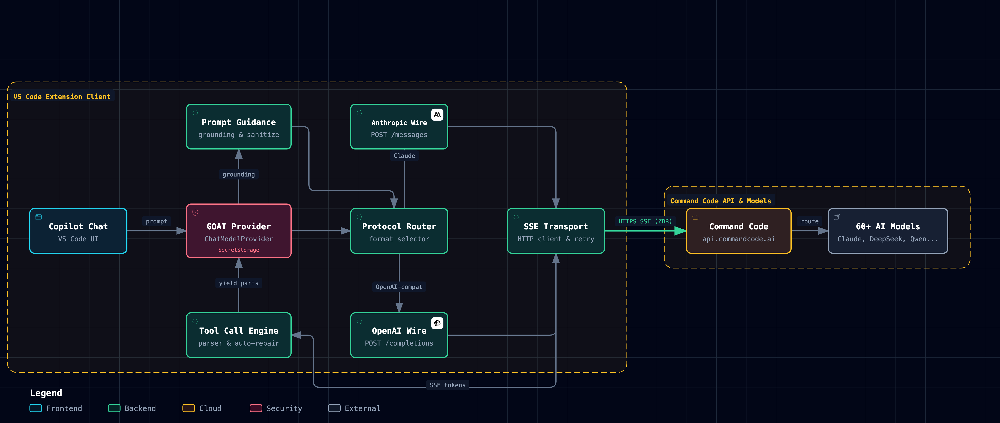

# Command Code GOAT Provider

[](LICENSE)

Command Code GOAT Chat Provider for GitHub Copilot in Visual Studio Code. Access 60+ AI models directly from the Copilot Chat model picker with streaming responses, tool calling, image understanding, and thinking/reasoning inspection.

---

## Features

- **60+ AI Models**: Full support for Claude 5 / 4.6 / 4.8 / 4.7 / Haiku 4.5, DeepSeek V4.1 Flash / V4 Pro / Flash, Kimi K3.1 / K3 / K2.7 / K2.6, GLM-5.3 / 5.2, MiniMax M3, Qwen 3.8 / 3.7, Gemini 3.7 / 3.6 / 3.5, Grok 4.6 / 4.5, Muse Spark, and more.
- **Dual Protocol Routing**: Automatically routes Claude models to the Anthropic Messages API (`/provider/v1/messages`) and other models to OpenAI-compatible Chat Completions (`/provider/v1/chat/completions`).
- **Zero Data Retention (ZDR)**: Optional configuration (`commandcode-goat.enableZdr`) to send `x-cmd-zdr: 1` header for strict compliance and privacy requirements.
- **Native Tool Calling & Thinking**: Assembles fragmented streaming tool calls in real time and renders model reasoning blocks in Copilot Chat.
- **Secure Key Storage**: API keys are securely stored in VS Code's `SecretStorage` (`commandcode-goat.apiKey`) and never written to workspace files or logs.
- **Resilient Streaming**: Automatic silent retries for empty or truncated responses and normalized error handling for rate limits, token ceilings, and authorization issues.

---

## Requirements

- **VS Code**: `1.104.0` or higher
- **GitHub Copilot**: Installed and active in VS Code
- **Command Code API Key**: From [Command Code](https://commandcode.ai)

---

## Setup & Configuration

### 1. Configure Your API Key

You can configure your API key in any of the following ways:

1. Open the Command Palette (`Ctrl+Shift+P` / `Cmd+Shift+P`), run **Command Code GOAT: Manage API Key**, and paste your API key.
2. Select any Command Code GOAT model in the Copilot Chat model picker; VS Code will prompt you for the API key if none is stored.

### 2. Optional Settings

In VS Code Settings (`Ctrl+,` / `Cmd+,`), search for `Command Code GOAT`:

- `commandcode-goat.enableZdr` (boolean, default: `false`): Enable Command Code Zero Data Retention mode (`x-cmd-zdr: 1`).

### 3. Commands

- **Command Code GOAT: Manage API Key** (`commandcode-goat.manage`): Set, update, or clear your stored API key.
- **Command Code GOAT: Toggle Debug Logging** (`commandcode-goat.toggleDebugLogging`): Enable or disable verbose debug logs in the output channel.
- **Command Code GOAT: Open Debug Log** (`commandcode-goat.openDebugLog`): Open the Command Code GOAT output channel.

### 4. GOAT Auto (optional)

GOAT Auto is an extra model in the Copilot Chat model picker. When you select it, the extension picks one model and reasoning effort per user turn from a pool you choose, then sends the request to that model as usual. All requests within one turn (for example, agent-mode tool rounds) reuse the same choice. Selecting any other model works exactly as before.

- **Command Code GOAT: Configure GOAT Auto Pool** (`commandcode-goat.auto.configurePool`): Pick the pool models from the current model list.
- `commandcode-goat.auto.pool` (string array, default: `[]`): Model ids GOAT Auto may route between. With an empty pool, GOAT Auto replies with setup instructions instead of calling a model.
- `commandcode-goat.auto.judgeModel` (string, default: `""`): OpenAI-format model that judges which pool model fits the turn. Leave empty to use a pool model whose id contains `flash` (else the first OpenAI-format pool model).

The judge makes one small request (4-second timeout). If it is unavailable, slow, or returns something unusable, a keyword/length heuristic decides instead: short single-line prompts go to a fast model at low effort, long or architecture/migration/debugging prompts go to the pool model with the largest context window at high effort, and everything else goes to the first pool model at medium effort. Conversations with images only route to vision-capable pool models (if the pool has any), and requests that exceed the chosen model's context escalate to the largest pool model. The routed effort follows the same per-model clamping as the picker setting and only applies to OpenAI-format models. Each decision is written to the debug log.

---

## Architecture

[](https://hidenobunagai.github.io/commandcode-goat-provider/)

> 🌐 **[View Interactive Architecture Diagram (GitHub Pages)](https://hidenobunagai.github.io/commandcode-goat-provider/)** — Explore guided flows, dual-protocol routing, and streaming tool repairs in an interactive SVG diagram.

---

## Model Catalog & Protocols

The provider dynamically discovers available models from `GET https://api.commandcode.ai/provider/v1/models` while maintaining static capability authority:

| Model Family | Examples | Wire Protocol | Thinking / Reasoning | Vision |
|---|---|---|---|---|
| **Anthropic Claude** | `claude-opus-5-5`, `claude-sonnet-5-5`, `claude-sonnet-5`, `claude-haiku-5-5`, `claude-opus-5` | Anthropic `/messages` | Automatic | Supported |
| **DeepSeek** | `deepseek/deepseek-v4.1-flash`, `deepseek/deepseek-v4-pro`, `deepseek/deepseek-v4-flash`, `deepseek/deepseek-v4-flash-fast`, `deepseek/deepseek-v4-flash-vision-exp` | OpenAI `/chat/completions` | Configurable effort | Supported on V4.1 Flash & Vision |
| **Moonshot Kimi** | `moonshotai/Kimi-K3.1-Pro`, `moonshotai/Kimi-K3`, `moonshotai/Kimi-K2.7-Code`, `moonshotai/Kimi-K2.6` | OpenAI `/chat/completions` | Configurable effort | Supported |
| **Zhipu GLM** | `z-ai/glm-5.3-flashx`, `z-ai/glm-5.3-flash`, `zai-org/GLM-5.3`, `zai-org/GLM-5.2` | OpenAI `/chat/completions` | Configurable effort | Text & Tools |
| **MiniMax** | `minimax/minimax-m3.1-flash`, `MiniMaxAI/MiniMax-M3`, `MiniMaxAI/MiniMax-M2.7`, `MiniMaxAI/MiniMax-M2.5` | OpenAI `/chat/completions` | Configurable effort | Supported (M3, M3.1) |
| **Alibaba Qwen** | `Qwen/Qwen3.8-Max-Prime`, `Qwen/Qwen3.8-Omni-Flash`, `Qwen/Qwen3.8-Max`, `Qwen/Qwen3.8-27B`, `Qwen/Qwen3.7-Max` | OpenAI `/chat/completions` | Configurable effort | Supported |
| **Google Gemini** | `google/gemini-4-argon`, `google/gemini-3.8-flash`, `google/gemini-3.7-flash` | OpenAI `/chat/completions` | Configurable effort | Supported |
| **xAI Grok** | `xai/grok-4.7`, `xai/grok-4.6`, `xai/grok-4.5` | OpenAI `/chat/completions` | Configurable effort | Supported |
| **Meta Muse** | `meta/muse-wonder-1.0`, `meta/muse-spark-open`, `meta/muse-spark-1.3`, `meta/muse-spark-1.3-contributor`, `meta/muse-spark-1.2` | OpenAI `/chat/completions` | Configurable effort | Supported |
| **Other Partners** | `ornith/ornith-1.5-122b`, `reflection/beam:free`, `nvidia/nemotron-3.5-super-vl`, `mistral/mistral-large-4`, `stealth/glyph-cluster:free`, `xiaomi/mimo-v2.6-pro`, `stepfun/Step-5-Preview` | OpenAI `/chat/completions` | Varied | Varied |

---

## Troubleshooting & Error Handling

- **401 / 403 Unauthorized**: Your API key is missing or invalid. Use `Command Code GOAT: Manage API Key` to update it.
- **422 Unprocessable Entity (ZDR mode)**: The selected model or account tier does not support Zero Data Retention. Toggle `commandcode-goat.enableZdr` to `false` in settings.
- **429 Rate Limit**: The provider rate limit has been exceeded. The extension retries with exponential backoff before surfacing errors. If Retry-After exceeds 30 seconds, an error is displayed immediately without waiting.
- **400 Token Limit Exceeded**: The conversation length exceeds the model's effective context limit. Reduce conversation history or switch to a 1M-token model.
- **5xx Server Errors**: Temporary provider outage. The extension automatically retries transient server errors up to 5 times.

---

## Development

```bash
# Install dependencies with Bun
bun install --ignore-scripts

# Compile TypeScript
bun run compile

# Run full test suite
bun run test -- --runInBand

# Lint and check formatting
bun run lint
bun run format

# Build VSIX package
bun run package:vsix

# Check the bundled catalog against the live Command Code API (exit 2 = drift)
bun run check:models
```

Model catalog updates — new-model curation, version bump, tag-driven publish — follow
[`docs/model-sync.md`](docs/model-sync.md). The same playbook runs automatically every day via the homepi
watch timer (`daily-model-watch.timer`).

---

## License

MIT © [Hidenobu Nagai](https://github.com/hidenobunagai)
